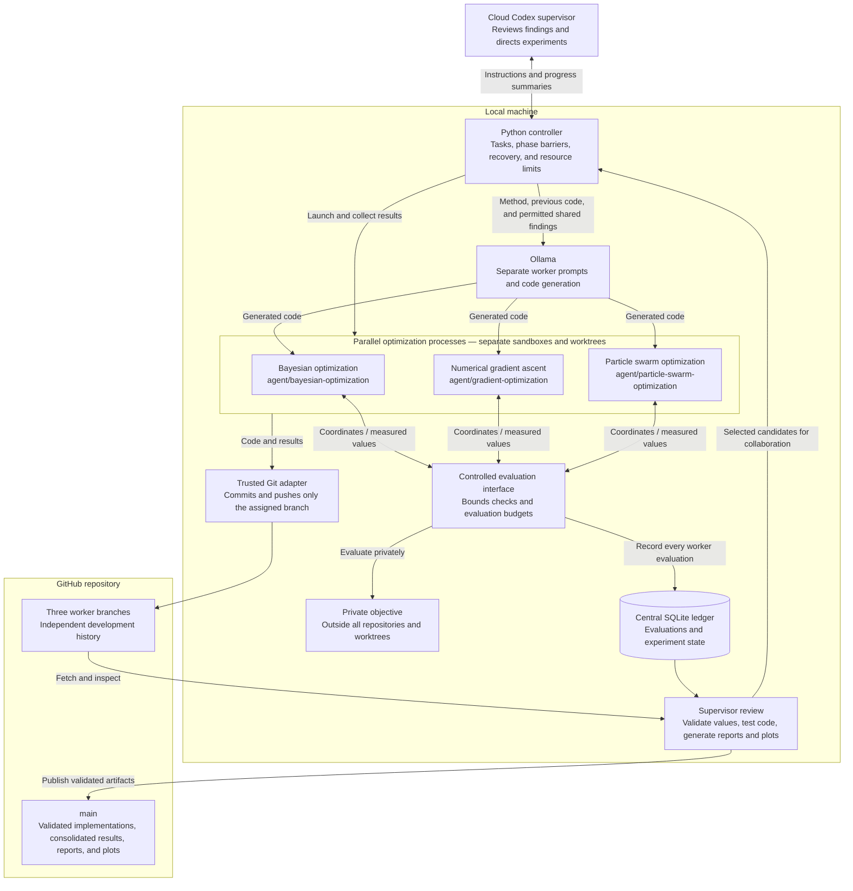

# Autonomous local multi-agent black-box optimization

A cloud Codex supervisor coordinates three local Ollama workers: Gaussian-process Bayesian optimization, numerical gradient ascent, and particle swarm optimization. Each worker independently authors code with Ollama, executes it in its assigned macOS sandbox/worktree, and publishes measured milestones through a branch-scoped Git adapter. No additional paid API is activated.

## System design

**Collaboration passes through the controller.** Each worker first spends 150 evaluations independently. After all three finish, the controller shares their measured best candidates with every worker for a further 150 evaluations each. Workers do not message one another directly or receive the hidden objective source. Ollama authors code; the sandboxed Python processes perform the optimization. Reviewed mode runs the checked-in implementations directly, bypassing Ollama code generation.

The cloud supervisor is the current Codex session. The optional CLI bridge supports automated supervisor requests; the local controller runs the experiment phases.

## Reproduce

Requires macOS with `sandbox-exec`, Python 3.9+, NumPy, Matplotlib, Git SSH authentication, and Ollama serving `qwen3.8:27b-mtp-q8_0` on localhost:11434.

1. Install `requirements.txt` into your preferred Python environment.
2. Fetch origin and create all three branches from the same main baseline: `agent/bayesian-optimization`, `agent/gradient-optimization`, `agent/particle-swarm-optimization`. Push them before launching workers.
3. Create sibling worktrees under `../multi-agent-worktrees/{bayesian,gradient,particle-swarm}`. Existing branches and worktrees must be inspected and reused, never reset.
4. Supply an external private Python module defining `black_box_function(x,y)` (supports NumPy arrays for supervisor plots). Keep it outside every repository and worktree, in a private directory under `/Users` or `/private/tmp`, which the worker policy denies.
5. From main run `python3 -m supervisor.orchestrator --objective /absolute/private/path/objective.py`.
6. Run tests with `python3 -m unittest discover -s tests -v`.

Inspect current progress without using a model with `python3 -m supervisor.status`.

The objective implementation is deliberately absent from Git. Workers receive only their method, bounds, evaluation interface and budget. Independent runs finish before the supervisor shares measured candidates. Each phase permits exactly 150 evaluations per worker. SQLite transactions centrally enforce budgets. Every recorded point is recalculated before reports are published. Landscape plots and final reference errors are supervisor-only and never sent to worker models.

## Recovery and publication

Rerun the same command after interruption. Persisted code is replayed with seed 42; completed evaluations are returned from the ledger without spending additional budget. Divergent replay fails closed. Completed phase result files are republished idempotently. A failed partially evaluated algorithm is preserved and requires explicit investigation rather than resetting its budget. Model-authoring requests are serialized to limit memory, while experiments run concurrently.

The supervisor publishes only tracked project paths; unrelated files such as the original user request are preserved. Git adapters verify branch identity, avoid force pushes, and verify origin SHA after every push. Non-fast-forward/protected-branch failures stop safely; reconcile changes or submit a PR before resuming.

## Isolation and trust

Ollama receives text and returns source; it has no tools or filesystem access. Generated optimization code runs with macOS Seatbelt rules that deny reads of user and temporary directories except its own worktree and NumPy dependencies, deny network access, and deny writes. The trusted worker adapter stages, commits and pushes only that worker's directory on its assigned branch. Git credentials and supervisor/other-worker files are unavailable to generated code. The evaluator executes in the supervisor process and communicates with workers using JSON over pipes.

For other objectives, use a new experiment ledger and worktrees/run directory to avoid mixing trials. One seeded run cannot establish statistical superiority or a causal benefit from collaboration.

## Automated cloud supervisor integration

The supported integration is `codex exec --json` ([official non-interactive documentation](https://developers.openai.com/codex/noninteractive)). This run's supervisor is the current Codex session; the reusable adapter in `supervisor/cloud_supervisor.py` is opt-in and never activates paid API usage automatically. Authenticate using your existing Codex account; assess billing before enabling API-key authentication.

## Reviewed algorithm improvements

The current reusable implementations are `workers/bayesian/algorithm.py`, `workers/gradient/algorithm.py`, and `workers/particle_swarm/algorithm.py`. Historical `independent/` and `collaborative/` code, results, and reports continue to describe the original experiment.

- **Bayesian:** normalize observed values; fit separate kernel length scales for each axis with a bounded marginal-likelihood search every 12 new calls. A maximum of 48 training points keeps fitting cost bounded. Diagnostics record selected scales, jitter, and fit scores.
- **Gradient:** cap each restart at 30 objective calls, including finite differences and backtracking. Restart on stagnation or a stationary gradient; alternate promising shared candidates with independent random starts.
- **Swarm:** reduce inertia linearly from 0.9 to 0.4 over post-initialization evaluations, cap velocities at 2, and retain random exploration when seeding from shared points.

All three retain the `optimize(evaluate, budget, seed, shared)` interface, support small and zero budgets, and report only newly measured observations as their own. Shared values never consume the new-call budget.

Local Ollama authoring now receives these reviewed baselines and explicit improvement requirements. For a fresh experiment, `--algorithm-source reviewed` runs the checked-in implementations directly through the same sandbox/evaluator without a model-authoring call. The default remains `--algorithm-source ollama`. Reviewed mode refuses to replace a different existing phase implementation; archive prior experiment code/results and use fresh tracking/worktrees for a new experiment rather than repurposing the completed 900-evaluation run. Reviewed code failures stop without an automatic model rewrite.

Validation includes synthetic fixtures, exact budgets, restart limits, inertia endpoints, kernel adaptation, determinism, and execution through the restricted interface. The previous benchmark is preserved; these code changes do not establish a new benchmark ranking.

## Benchmark the reviewed versions without replacing the original run

Run `python3 -m supervisor.benchmark_improvements --objective /absolute/private/path/objective.py --run-id improved-seed42-v1` from main. This uses the existing assigned worker branches/worktrees, separate `workers/<method>/runs/<run-id>/<phase>` directories, and an isolated ledger under `experiments/runs/<run-id>/`. Each method gets 150 independent and 150 collaborative calls with seed 42. The collaboration candidates come exclusively from that new independent phase. Source hashes and the objective hash guard against incompatible resumption. Completed evaluations replay from the new ledger on restart.

The runner pushes each worker's results after each phase and creates a comparison report, CSV/JSON, and convergence plot on main's filesystem for review/publication. It does not rewrite the original run or automatically push main. Reusing a run ID resumes that run; a new ID starts a new evaluation budget.

The first reviewed benchmark is in `experiments/runs/improved-seed42-v1/`. All three final best values regressed versus the original run. These changes passed correctness tests but have not demonstrated better final benchmark performance.
